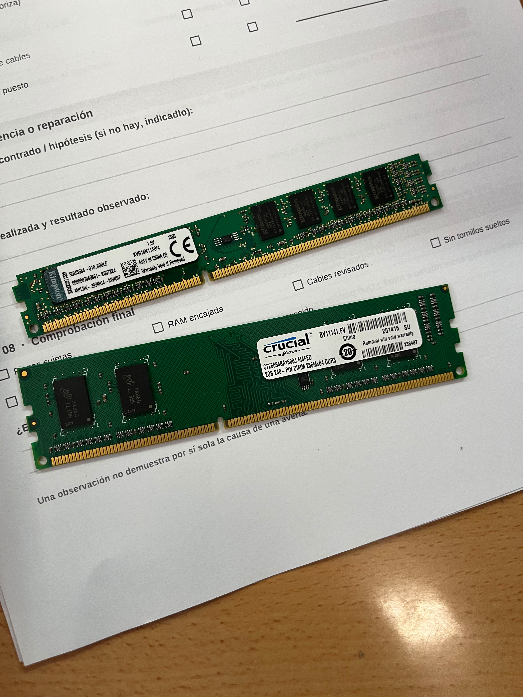
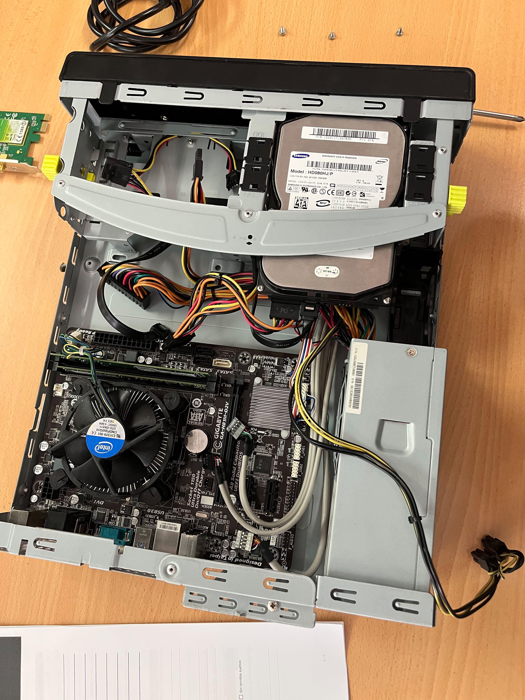
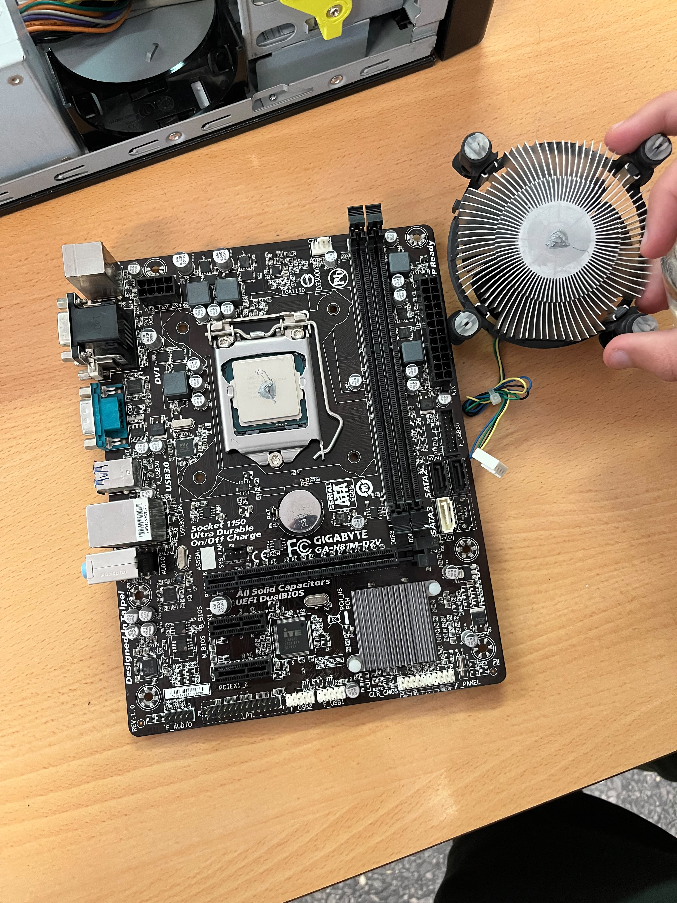
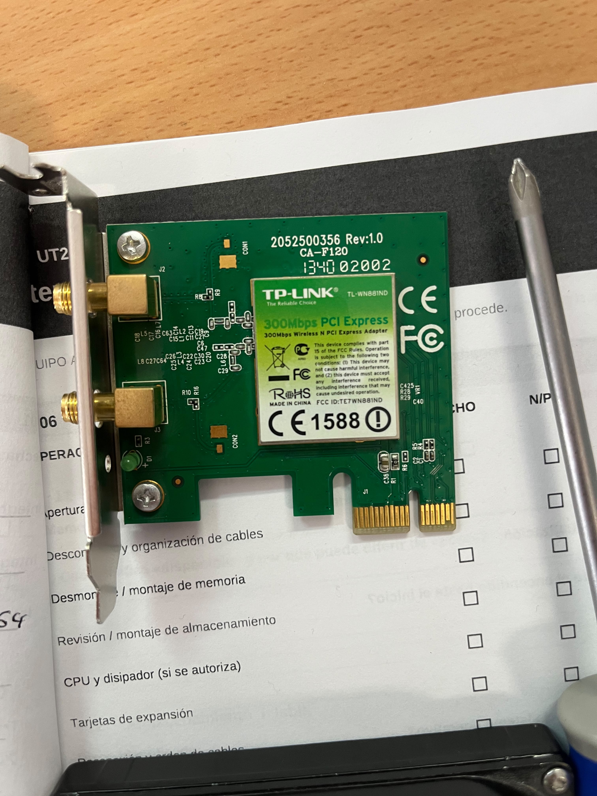
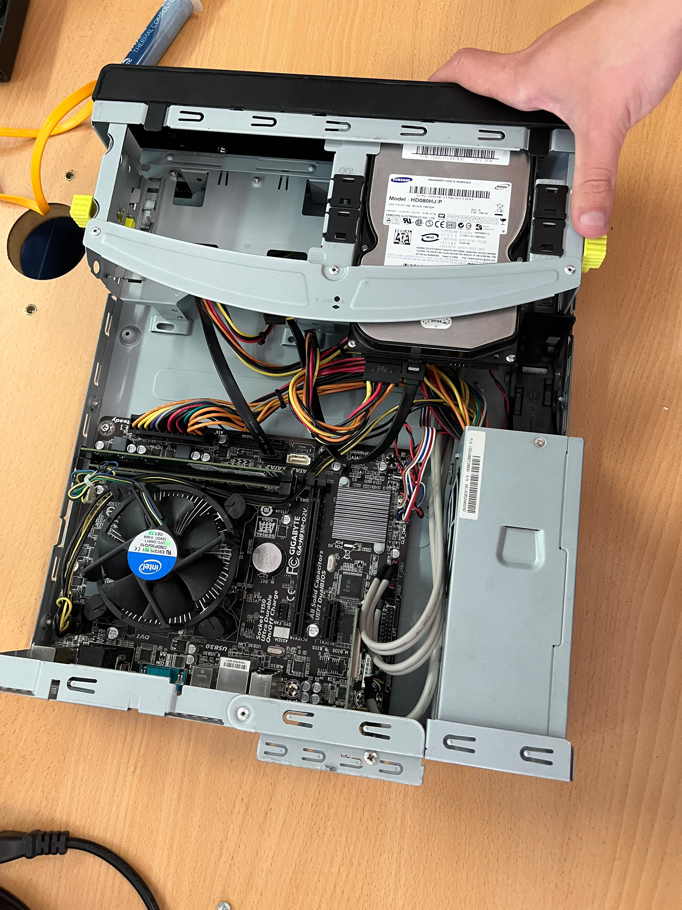

# SI · UT2 — Ficha de taller: montaje y revisión de un ordenador

## 1. Orden de trabajo

**Fecha:** 15/11/2026  **Puesto:** ____________________  **Equipo / etiqueta:** ____________________

**Integrantes del grupo (2 o 3):**

1. Nombre y apellidos: Iván Jelti Roldán
2. Nombre y apellidos: Luis Alfonso Ortega Correa
3. Nombre y apellidos (si procede): __________________________________

> **Equipo A:** ordenador de prácticas utilizado para el montaje o la revisión. Puede estar averiado; no se exige que arranque.
>
> **Equipo B:** vuestro propio ordenador funcional. Se utiliza a partir del apartado 9 para analizar el arranque y el hardware desde Linux.

## 2. Recepción e inspección visual · Equipo A

**Trabajo previsto:**

- [X] Desmontaje y montaje
- [ ] Revisión / diagnóstico
- [ ] Otro: ___________________________________

**Estado al recibirlo:**

- [X] Completo
- [ ] Faltan piezas
- [ ] Sucio
- [ ] Daños visibles

**Síntomas conocidos, piezas ausentes o daños observados:**

Tornillo suelto independiente al montaje.

## 3. Seguridad y preparación · Equipo A

- [X] Equipo desconectado de la corriente y de los periféricos.
- [X] Botón de encendido pulsado tras desconectar.
- [X] Superficie despejada y piezas organizadas.
- [X] Estado inicial y conexiones fotografiados.

**Herramientas utilizadas:** Destornillador Phillips imantado, alcohol isopropílico, papel y pasta térmica.

**No abráis la fuente ni forcéis piezas.** Ante daños o baterías, avisad al profesor.

## 4. Componentes identificados · Equipo A

Anotad lo que podáis verificar. Si no se distingue, escribid «no identificado».

| Componente | Marca / modelo | Dato observado |
|---|---|---|
| Placa base |Gigabyte GA-HB1M-D2V |Socket 1150 |
| Procesador |Intel Pentium G3220 |3GHZ |
| RAM |Kingston/Crucial DIMM |8GB/2GB DDR3 240CL 256Mx64 |
| Almacenamiento |SAMSUNG HD080HJ/P |80GB 3Gb/s |
| Fuente |POWER MAN IP-S300EF7-2 H |300W 80 PLUS BRONZE |
| Disipador / ventilador |Intel FAN |disipador de serie |
| Tarjetas / otros |TP-LINK TL-WN881ND |300Mbps PCI Express |

## 5. Conexiones y observaciones · Equipo A

Identificad y marcad las conexiones presentes y comprobadas:

- [X] Alimentación de la placa
- [X] Alimentación de la CPU
- [X] Ventilador de la CPU
- [X] Datos de almacenamiento
- [X] Alimentación del disco
- [X] Panel frontal

**¿Hay algún cable suelto, conector dañado o conexión que no sepáis identificar?**

Solo había un tornillo suelto que era independiente al montaje y desmontaje.  

**Fotografías de referencia (nombre de archivo o ubicación):**

No retiréis la CPU ni el disipador sin indicación del profesor. Si se retira el disipador, consultad sobre limpieza y pasta térmica antes de volver a instalarlo.

## 6. Registro del trabajo · Equipo A

Registrad únicamente lo que hayáis hecho; marcad **N/P** si no procede.

| Operación | Hecho | N/P | Foto / observaciones |
|---|:---:|:---:|---|
| Apertura y fotos iniciales | X | ☐ | |
| Desconexión y organización de cables | X | ☐ | |
| Desmontaje / montaje de memoria | X | ☐ | |
| Revisión / montaje de almacenamiento | X | ☐ | |
| CPU y disipador, si se autoriza | X | ☐ | |
| Tarjetas de expansión | X | ☐ | |
| Reconexión y orden de cables | X | ☐ | |
| Cierre y limpieza del puesto | X | ☐ | |

## 7. Incidencia o reparación · Equipo A

**Problema encontrado / hipótesis** (si no hay, indicadlo):

Durante el montaje y desmontaje no ha habido ningún problema.

**Acción realizada y resultado observado:**

________________________________________________________________________

________________________________________________________________________

________________________________________________________________________

## 8. Comprobación final · Equipo A

- [X] Piezas sujetas.
- [X] RAM encajada.
- [X] Cables revisados.
- [X] Sin tornillos sueltos.
- [X] Ventilador de CPU conectado.
- [X] Puesto recogido.

**¿Encendido autorizado?** X Sí  ☐ No

**Resultado / motivo:** Encendido sin ningún problema.

Una observación no demuestra por sí sola la causa de una avería.

---

## 9. Identificación y arranque · Equipo B

Utilizad vuestro propio ordenador funcional para los siguientes apartados.

**Equipo:** X Portátil  ☐ Sobremesa  ☐ Otro: ___________________________

**Linux:** X Instalado directamente  ☐ Máquina virtual

**Sistema operativo y versión:** Windows 11 Home y Omarchy

**Si es virtual: sistema anfitrión y programa de virtualización:** ______________

**¿Arranca con normalidad? ¿Qué observáis desde el encendido hasta el inicio?**

Arranca con normalidad, permitiendo escoger que sistema operativo arrancar gracias al Dual-Boot.

**¿Qué es el POST y en qué se diferencia de la UEFI y del sistema operativo?**

El POST es un firmware que ejecuta una autocomprobación del hardware para así poder detectar posibles fallos en el ordenador.
La UEFI que se encarga de identificar los dispositivos de arranque disponibles y su orden de arranque.
El Sistema Operativo se encarga de ejecutar los programas de manera intuitiva para el usuario.

**¿Habéis accedido a la UEFI o consultado información de ella? ¿Qué dato habéis visto?**

Al acceder a la UEFI me muestra caracteristicas del ordenador y de seguridad que me habilitan modificar y también me muestra el orden del arranque del ordenador con opción a arrancar cualquier sistema operativo que tengo instalado en mi ordenador.  

No cambiéis ajustes de UEFI sin indicación del profesor. Si no podéis acceder, indicadlo.

## 10. Linux: procesador · `lscpu`

Ejecutad `lscpu`. Adjuntad la salida revisada o indicad si el comando falla.

**Modelo / CPU presentada a Linux:** 

Intel(R) Core(TM) 7 240H 

**Arquitectura:** x86_64  **CPU lógicas visibles:** 16

**¿Qué diferencia hay entre núcleo e hilo? ¿Qué podéis concluir de la salida?**

Los núcleos son unidades de procesamiento que se encargan de buscar, decodificar y ejecutar las instrucciones obtenidas mediante los hilos que son secuencias de instrucciones lógicas  provenientes de la memoria y otros componentes del ordenador.

## 11. Linux: memoria · `free -h`

Adjuntad las salidas de los comandos. Si alguno falla o no está disponible, anotadlo. Antes de entregarlas, ocultad usuarios, nombres de equipo, números de serie y UUID. En una máquina virtual pueden mostrarse recursos virtuales, no el hardware físico completo.

**Memoria total:** 30Gi  **Memoria disponible:** 25Gi

**¿Qué significa «disponible» y por qué puede diferir de «libre»?**

El uso de libre o disponible en el sector del Hardware hace referencia a la cantidad de memoria que puedes utilizar de la memoria total teniendo en cuenta la memoria que esta siendo utilizada en este momento. 

## 12. Linux: almacenamiento · `lsblk`

**Disco identificado:** nvme0n1

**Partición y punto de montaje, si aparecen:** nvme0n1(p1,p2,p3,p4,:/boot,p5,p6:/home/var/cache/pacman/pkg/var/log/)

**Explicad la diferencia entre disco, partición y punto de montaje:**

El disco es la unidad de almacenamiento que se utiliza en los PC y servidores.
La partición es una división o parte del disco que se suele utilizar para algo concreto como añadir un segundo sistema operativo sin necesidad de eliminar el primero.
El punto de montaje es la ubicación en la que se encuentra la partición del disco.

## 13. Linux: dispositivos · `lspci` y `lsusb`

**Dispositivo 1 y función:** 

**Dispositivo 2 y función:** 

**¿Por qué podría no aparecer un componente físico o mostrarse de otra forma en una máquina virtual?**

________________________________________________________________________

____________________________________________________________________

## 14. Duda técnica y uso crítico de IA

Podéis usar una IA de Internet. No compartáis datos personales ni información privada del centro. Sin acceso a IA, resolved la duda con una fuente técnica.

**Herramienta utilizada y fecha:**

________________________________________________________________________

**Pregunta planteada:**

________________________________________________________________________

________________________________________________________________________

**Respuesta resumida y afirmación concreta que decidisteis comprobar:**

________________________________________________________________________

________________________________________________________________________

________________________________________________________________________

**Fuente técnica o prueba utilizada y resultado:** confirmada / corregida / no verificada.

________________________________________________________________________

________________________________________________________________________

## 15. Valoración y entrega

**¿Qué paso fue más difícil y cómo lo resolvisteis?**

La parte del arranque y Hardware desde Linux ya que requería de la búsqueda en las respuestas de los comandos mediante los conocimientos obtenidos en clase junto al criterio propio para poder responder a cada pregunta. 

**¿Qué relación existe entre el montaje y la información de Linux? Recordad que son equipos distintos.** 

Su relación se encuentra en que para el correcto funcionamiento de un ordenador necesitas ambos ya que para poder obtener la información requieres de un montaje y para el montaje requieres de la información para que el ordenador funcione. 

**¿Qué haríais de otra manera en un próximo montaje?**

Organizar de mejor manera los componentes a la hora del desmontaje.

Antes de entregar:

- [ ] Ficha completa.
- [ ] Fotos identificadas.
- [ ] Salidas de Linux revisadas.
